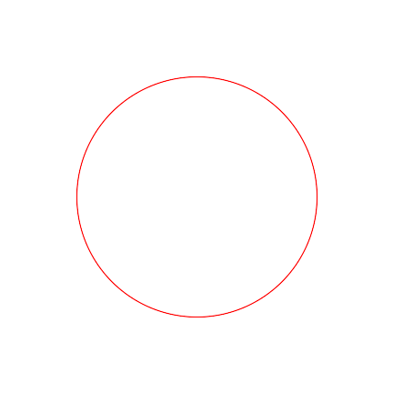

# Аудит комплекта FrostMost Brand Kit v1

Дата: 2026-11-08
Объект: комплект `frostmost-brand-kit` v1 (10 SVG знаков и иконок, 2 документа палитры, README).
Метод: сверка с кодом форка, пересчёт контрастов по WCAG 2.1, отрисовка SVG в 24/48/96/432/512 px.

Вердикт: концепт принят как направление, ни один файл не принят как ассет. Комплект провалил
собственную приёмку по трём пунктам брифа (24 px, safe zone, контрасты) и документировал
снятую редакцию палитры.

---

## 1. Знак не выживает на 24 px (бриф §3.2, §6)

Пик и арка разделены зазором ≈9 единиц холста. При 24 px это 2.2 px: сглаживание закрывает
просвет, и знак читается как монолитная буква «A», а не как «пик + проход».

Причина не только в зазоре: арка была ниже и шире основания пика, поэтому боковые «усы» пика
выступали за неё. Деталей было четыре, бриф §3.1 просит одну-две.

Лечится параметрами (контракт §1.2): зазор ≥ 15 единиц, толщина ≥ 5, габарит 14..86,
строго 2 формы, арка не шире основания пика.

## 2. Adaptive foreground выходит за safe zone (бриф §3.1)

Оба файла adaptive icon нарисованы на `viewBox="0 0 100 100"`, тогда как канва Android — 108
единиц с безопасным кругом диаметра 66 (радиус 33) в центре. Сам бриф v1 заявлял «66 из 108»,
то есть арифметика была известна и не применена.

Красная линия — граница безопасного круга. Апекс пика выходит за неё сверху, концы арки —
по бокам. Круглая маска, стоящая по умолчанию у большинства лончеров, срезает ровно те два
штриха, которыми знак опознаётся.

Лечится перерисовкой на канве 108 с запасом ≥ 2 единиц (контракт §2).

## 3. Градиент заявлял три цвета, показывал два

Стопы: `#258CFF` → `#0759E8` @ 0.52 → `#173CB8`. Линейная середина между концами — `#1E64DC`;
заявленный средний стоп на пути между ними не лежит вовсе и визуально не проявляется.

Дополнительно `#258CFF` на белом даёт `3.35:1` — ниже порога 3:1 для нетекстовой графики,
если этот синий когда-либо понадобится как самостоятельный графический элемент на светлом фоне.

Решение v2: градиента нет ни в одной версии (контракт §0.1). Основание — бриф §3.1
(Android 13+ перекрашивает иконку в один цвет) и §6 («два цвета или градиент, без которых знак
не узнаётся» — прямой пункт брака).

## 4. Палитра подписок взята из снятой редакции карты

Восемь раз в комплекте написано «цвета шести подписок перенесены из карты интерфейса» со ссылкой
на `2026-11-08-fork-ui-design-map.md`. В актуальной редакции этого файла (раздел 1.1) данной
палитры уже нет:

| # | Комплект v1 | Код приложения (`HOME_ACCENTS`) |
|---|---|---|
| 0 | синий `#2447C8` / `#3556D6` | индиго `#3D57B2` / `#3550B8` |
| 1 | фиолетовый `#6B2A80` / `#853197` | фиолетовый `#734B9D` / `#6B4299` |
| 2 | бирюзовый `#0E6A70` / `#0C6E75` | бирюзовый `#1F676F` / `#14606A` |
| 3 | зелёный `#1F6B3A` / `#1E6B3C` | зелёный `#2C6944` / `#25603B` |
| 4 | винный `#8C1D40` / `#A1254C` | роза `#93435E` / `#8C3A55` |
| 5 | бронзовый `#7A4A00` / `#8F5600` | янтарный `#825228` / `#7A4A18` |

Винный и бронзовый были **сознательно сняты**: карта прямо объясняет, что это были самые тяжёлые
тона и что винный к тому же доставался случайной подписке. v1 вернул оба цвета в качестве
витринных иконок подписок.

Практическое следствие: иконка «синей подписки» `#2447C8` и настоящий акцент приложения `#3D57B2`
различимы на `1.14:1`, то есть визуально это разные цвета. Комплект показывал то, чего
приложение никогда не нарисует.

Плюс фактическая ошибка о происхождении индекса: v1 утверждает, что индекс иконки выбирается
«на основе ID группы». В коде `accentFor(position)` берёт **позицию подписки в списке групп**,
а не id.

## 5. Две цифры контраста были ложными

| Утверждение v1 | Факт (WCAG 2.1) |
|---|---|
| «Белый текст на всех шести цветах имеет контраст не ниже 6.0:1» | минимум `5.995:1` (бирюзовый `#0C6E75`, тёмная тема) — ниже 6.0 |
| «На плашке с альфой 0.10 минимальный контраст 4.85:1» | минимум `4.8429:1` (тот же бирюзовый) — ниже 4.85 |

Порог AA 4.5:1 в обоих случаях держится, но заявленные числа неверны: они записаны, а не
посчитаны. В этом проекте такие числа обычно держит тест, а не глаз.

Отдельно: `success #0A7455` на тёмном `#1C1B1F` даёт `2.97:1` — это дефект самой схемы
приложения, не комплекта; в v2 он фиксируется фактом, но не чинится (тема вне области).

## 6. Локапы непригодны из-за `<text>`

Оба логотипа набирают название элементом `<text font-family="Inter, Manrope, Arial">`.
Шрифт не вшит: на машине без Inter надпись тихо переезжает на Arial с другими метриками, а
горизонтальная композиция спроектирована под конкретную ширину метрик Inter. В Android-проекте
fallback — Roboto.

В v1 также: в горизонтальном локапе надпись стояла с непроверенным правым запасом, а в
вертикальном между знаком и надписью оставалось ≈57 единиц пустоты из 100.

Решение v2: надпись переводится в кривые, `<text>` не остаётся ни в одном файле
(контракт §5).

## 7. Что в v1 сделано правильно и переносится в v2

1. **Разделение слоёв adaptive icon** (foreground и background отдельно, не склеенная картинка) —
   правильная архитектура; `ic_launcher.xml` в проекте уже ждёт таких слоёв.
2. **Монохромные версии действительно монохромные** — одна заливка без градиента, как требует
   бриф §3.1. Требование пережило и обесценивает градиент только в цветных версиях.
3. **Равнодостоинство палитры по контрасту**: все 12 цветов лежат в узком коридоре 5.99–9.26,
   ни один акцент не звучит громче остальных. Это хорошее свойство, и в v2 оно сохраняется
   (палитра приложения держит 6.51–7.46).
4. **Композиция знака** (пик над аркой) выбрана верно и передана в v2 без смены концепции.

## 8. Решение по брендовому синему (принято владельцем продукта)

Новый синий в продукт не вводится. Брендовый цвет — акцент подписки №0 из кода:
`#3D57B2` (светлая тема) и `#3550B8` (тёмная).

Проверка близости к текущему `primary #0B57D0`:

| Кандидат | Отношение контраста | ΔE | Годен как знак на белом |
|---|---|---|---|
| `#3D57B2` | `1.026:1` | 17.8 | `6.55:1` да |
| `#3550B8` | `1.099:1` | 10.3 | `7.02:1` да |
| `#0B57D0` текущий primary | 1.000 | 0.0 | `6.39:1` да, но тёмная пара `#AAC7FF` на белом даёт `1.69:1` |

`primary` сам как знак не годится: в тёмной теме он равен `#AAC7FF` и на белом не читается
вовсе. Акцент 0 имеет светлую и тёмную пару по построению, поэтому один токен обслуживает и
иконку, и интерфейс. `Theme.kt` при этом не меняется ни на строку.

Роль `primary` («главное действие экрана») и роль бренда остаются разными, как и предписывает
схема: совпадение значений не требуется, подмена запрещена.
